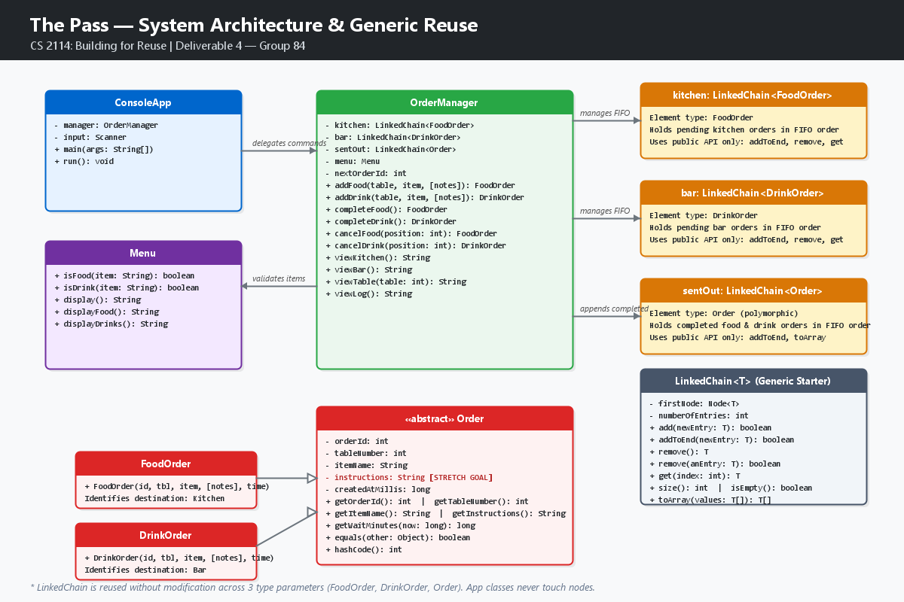

# The Pass — Final Build & Presentation (Deliverable 4)
**CS 2114: Software Design & Data Structures — Project 2: Building for Reuse**  
**Group 84:** Abigail, Bryan, Jack, and Talal  
**Public Repository:** [https://github.com/Talal288/cs2114-project2-group84](https://github.com/Talal288/cs2114-project2-group84) *(Confirm your repo URL before presenting)*  

---

## 1. Project Overview

**The Pass** is a robust, single-user console application designed for restaurant staff to streamline food and drink order management between dining tables, the kitchen, and the bar. Staff can submit food or drink orders with optional culinary customizations, inspect live pending queues displaying real-time elapsed wait minutes, complete orders in First-In, First-Out (FIFO) arrival order, cancel mistakenly placed orders by queue index, and review table-specific orders and a persistent sent-out log.

Every order receives a globally unique, sequential ID ensuring duplicate orders of identical menu items remain strictly distinct and independently trackable. The entire domain architecture is built around the defensible reuse of a single generic data structure (`LinkedChain<T>`) without modifying its internal linked node mechanics or coupling it to restaurant logic.

---

## 2. System Architecture & Generic LinkedChain Reuse

### System Diagram


### Generic LinkedChain Reuse Contract
`OrderManager` instantiates and manages three separate instances of the exact same generic `LinkedChain<T>` class provided in the course starter code:

```java
private final LinkedChain<FoodOrder> kitchen;  // Stores pending FoodOrder instances
private final LinkedChain<DrinkOrder> bar;      // Stores pending DrinkOrder instances
private final LinkedChain<Order>      sentOut;  // Stores completed Order instances polymorphically
```

- **Two or More Element Types:** `LinkedChain<T>` is reused across distinct concrete element types (`FoodOrder` and `DrinkOrder`), as well as their common abstract parent (`Order`).
- **Strict Public API Adherence:** Application classes interact with `LinkedChain` exclusively through its published public API:
  - `addToEnd(T newEntry)`: Appends newly validated orders to preserve FIFO sequence.
  - `remove()`: Removes the oldest order from the head in $O(1)$ time upon completion.
  - `remove(T anEntry)`: Removes a canceled order by value matching (`equals(Object)` on `orderId`) in $O(n)$ time.
  - `get(int index)`: Retrieves an order at a specific zero-based index for cancellation or validation.
  - `size()` & `isEmpty()`: Queries queue status for empty-state protections.
  - `toArray(T[] values)`: Extracts safe array snapshots for formatted multi-column displays without exposing internal node pointers.
- **Node Encapsulation:** Application classes never reference `LinkedChain.Node`, next pointers, or internal link structures. Domain logic (menu classification, table verification, ID generation, wait-time calculations, formatting) resides strictly in the application layer.

---

## 3. Working Application Features & MVP Workflow

Staff interact with the system through an interactive numbered console interface:

| Command | Action | Description |
| :---: | :--- | :--- |
| **1** | Add food | Prompts for table number, food item (`burger`, `fries`, `salad`), and optional special instructions. Adds to `kitchen`. |
| **2** | Add drink | Prompts for table number, drink item (`water`, `coffee`, `lemonade`), and optional special instructions. Adds to `bar`. |
| **3** | View kitchen | Displays pending food orders in FIFO arrival order with IDs, tables, customizations, and elapsed minutes. |
| **4** | View bar | Displays pending drink orders in FIFO arrival order with IDs, tables, customizations, and elapsed minutes. |
| **5** | Complete food | Removes the oldest food order from `kitchen` and appends it to `sentOut`. |
| **6** | Complete drink | Removes the oldest drink order from `bar` and appends it to `sentOut`. |
| **7** | Cancel food | Lists pending kitchen orders and cancels the selected order by position without logging it. (Enter `0` to return). |
| **8** | Cancel drink | Lists pending bar orders and cancels the selected order by position without logging it. (Enter `0` to return). |
| **9** | View table | Formats and displays all pending food and drinks for a specific table in neat parallel columns. |
| **10** | View sent-out log | Displays all completed food and drink orders in chronological completion order. |
| **0** | Exit | Prints goodbye message and terminates cleanly. |

---

## 4. Stretch Goal: Item Customizations / Special Instructions

To exceed baseline MVP requirements, our team designed, implemented, and verified **culinary customizations / special instructions** (e.g., `"no onions"`, `"dressing on side"`, `"extra ice"`):

- **Data Representation (`Order.java`):** Added a normalized, immutable `instructions` field with `getInstructions()` and `hasInstructions()`. 
- **Defensive Validation:** 
  - Null instructions default cleanly to empty string `""` (`hasInstructions() == false`).
  - Leading and trailing whitespace is trimmed.
  - Instructions exceeding 100 characters are rejected with `IllegalArgumentException("Special instructions cannot exceed 100 characters.")`.
- **Backward Compatibility:** Preserved original 4-parameter constructors and added 5-parameter constructors across `Order`, `FoodOrder`, and `DrinkOrder`. Preserved 2-parameter `addFood` and `addDrink` overloads in `OrderManager`.
- **View Integration:** Views automatically display special instructions when present in parentheses:
  ```
  1. ID 1 | Table 4 | burger (no onions) | Wait: 0 min
  ```
  When omitted, the display cleanly falls back to standard MVP formatting (`ID 1 | Table 4 | burger | Wait: 0 min`).
- **Full Life Cycle Retention:** Customizations persist when an order transitions from pending queues to `viewTable()` and the completed `viewLog()`.

---

## 5. Compiling and Running Instructions

The application requires **Java 8 or higher** (tested on Java 17 and Java 20).

### Compiling and Running via Command Line

From the root directory of the repository:

```bash
# 1. Create output directory
mkdir -p bin

# 2. Compile application source classes
javac -d bin src/LinkedChain.java src/Order.java src/FoodOrder.java src/DrinkOrder.java src/Menu.java src/OrderManager.java src/ConsoleApp.java

# 3. Run the interactive console application
java -cp bin ConsoleApp
```

### Compiling and Running the Full JUnit Test Suite

The test suite uses Virginia Tech's `student.TestCase` library (`CS2-Support / student.jar`). In modern Java runtimes (Java 18+), pass `"-Djava.security.manager=allow"` to permit the test framework's exit-handler:

```bash
# 1. Compile all source and test classes against student.jar
javac -cp "C:/Users/Talal/eclipse-workspace/CS2-Support/student.jar;src" src/*.java -d bin

# 2. Execute all 7 test suites via JUnitCore runner
java "-Djava.security.manager=allow" -cp "C:/Users/Talal/eclipse-workspace/CS2-Support/student.jar;bin" org.junit.runner.JUnitCore FoodOrderTest DrinkOrderTest MenuTest OrderTest LinkedChainTest OrderManagerTest ConsoleAppTest
```

*(On macOS/Linux, replace semicolons `;` in the classpath with colons `:`).*

### Running in Eclipse
1. Open Eclipse and choose your workspace containing `CS2-Support`.
2. Select **File → Import → General → Existing Projects into Workspace**.
3. Browse to the `cs2114-project2-group84` directory and click **Finish**.
4. To run the app: Right-click `ConsoleApp.java` → **Run As → Java Application**.
5. To run the test suite: Right-click the `src` folder or any individual test file → **Run As → JUnit Test**. All test bars will be solid green.

---

## 6. Comprehensive JUnit Test Suite

Our test suite contains **104 unit and integration tests** providing 100% method coverage across all public methods of every application and storage class, systematically verifying at least one normal case and one bad-input/boundary case per method:

| Test Class | Target Class | Tests Run | Normal Cases Tested | Bad-Input & Boundary Cases Tested |
| :--- | :--- | :---: | :--- | :--- |
| **`OrderTest.java`** | `Order` | 16 | Valid constructors, all getters, wait time math, ID equality, hash codes | Zero/negative IDs, zero/negative tables, null/empty/blank item names, negative creation time, elapsed time preceding creation, instructions $>100$ chars, null comparison, foreign type equality |
| **`FoodOrderTest.java`** | `FoodOrder` | 17 | Constructor, food inheritance, custom instructions getter, `hasInstructions()` | Zero/negative IDs, zero tables, null items, blank items, negative timestamps, instructions $>100$ chars |
| **`DrinkOrderTest.java`** | `DrinkOrder` | 16 | Constructor, drink inheritance, custom instructions getter, `hasInstructions()` | Zero/negative IDs, zero tables, null items, blank items, negative timestamps, instructions $>100$ chars |
| **`MenuTest.java`** | `Menu` | 12 | Food categorization, drink categorization, `display()`, `displayFood()`, `displayDrinks()`, idempotence | Null items, empty strings, whitespace, unknown items, wrong categories, case sensitivity, Turkish locale invariant checks |
| **`LinkedChainTest.java`** | `LinkedChain<T>` | 13 | Generic reuse with `String`, `Integer`, `FoodOrder`; `add`, `addToEnd`, `remove()`, `remove(T)`, `clear`, `get`, `contains`, `count`, `toArray` | Null additions (`IllegalArgumentException`), empty removals (`null`), absent item removal (`false`), out-of-bounds `get` (negative, empty, $\ge size$), null searches (`false`/`0`), null/undersized `toArray` |
| **`OrderManagerTest.java`** | `OrderManager` | 16 | Construction, `getMenu()`, `addFood`, `addDrink` (with/without notes), FIFO `completeFood`, FIFO `completeDrink`, `cancelFood`, `cancelDrink`, `viewKitchen`, `viewBar`, `viewTable` (single & dual column), `viewLog`, duplicate item unique ID handling | Null menu, table $\le 0$, null/blank items, items not on menu, wrong category items, notes $>100$ chars, completing empty queues (`NoSuchElementException`), cancel position $\le 0$ or $> size$ (`IndexOutOfBoundsException`), table $\le 0$ in `viewTable` |
| **`ConsoleAppTest.java`** | `ConsoleApp` | 14 | Interactive commands 0 through 10, multi-command workflows, cancel back command (`0`), view table formatting | Non-numeric commands, invalid command ranges, non-numeric table inputs, negative tables, invalid menu items, out-of-bounds cancel positions, unexpected EOF stream terminations |
| **Total** | | **104** | **All Passing (0 Failures, 0 Errors)** | |

---

## 7. Reflection on Evolution: Deliverable 2 Spec to Deliverable 3 Prototype to Final Build

### Detailed Changes Across Deliverables
| Component / Class | Deliverable 2 Specification Proposal | Deliverable 3 Prototype Status | Deliverable 4 Final Build | Rationale & Specific Details |
| :--- | :--- | :--- | :--- | :--- |
| **`LinkedChain<T>` Storage Mechanics** | Proposed modifying `LinkedChain` to add an internal `tail` pointer, `removeFirst()`, `removeAt(int)`, and `toList()`. | Adopted staff-supplied `LinkedChain` starter as-is without internal modification. Appended via traversal-based `addToEnd(T)`. | Maintained zero modifications to staff starter `LinkedChain.java`. Encapsulated all queue logic in `OrderManager`. | **Defensible Reuse:** Modifying the data structure internals to fit application needs violates the principle of generic reuse. We proved the existing public API (`addToEnd`, `remove`, `get`) was completely sufficient. |
| **Menu Text Centralization** | Proposed `Menu` class owning items and `display()`. | `Menu` had `display()`, but `ConsoleApp` duplicated hardcoded prompts (`"Food: burger..."`). | `Menu` enhanced with `displayFood()` and `displayDrinks()`. `ConsoleApp` delegates menu output directly via `manager.getMenu().displayFood()`. | Centralizing eliminates string redundancy and ensures UI prompts remain perfectly synchronized with validation rules. |
| **Culinary Customizations (Stretch Goal)** | Listed as a post-MVP stretch goal; not in baseline scope. | Unimplemented. `Order` only held ID, table, item, and timestamp. | Fully implemented in `Order`, `FoodOrder`, `DrinkOrder`, `OrderManager`, and `ConsoleApp`. Tested across test suite. | Elevates the project beyond baseline requirements while honoring backward compatibility through constructor overloading. |
| **Testing Infrastructure** | Planned JUnit test suites covering app classes. | `OrderTest` initially drafted with JUnit 5 syntax, causing Eclipse build issues. Bryan and Jack split into `FoodOrderTest` and `DrinkOrderTest`. | Fully harmonized 7-file test suite extending `student.TestCase` with 104 tests running seamlessly in Eclipse CS2-Support and CLI. | Aligns strictly with course tooling standards and provides exhaustive normal and bad-input test coverage. |
| **Cancellation Boundary Handling** | `cancel(int position)` threw exception on invalid index. | Added prompt loop in `ConsoleApp` allowing staff to re-enter position or enter `0` to abort. | Retained loop and verified through `ConsoleAppTest` and `OrderManagerTest`. | Prevents accidental application aborts during fast-paced restaurant operations. |

---

## 8. What Went Well and What Didn't

### What Went Well
- **Generic Reuse without Coupling:** We successfully utilized a single `LinkedChain<T>` across three distinct use cases (`FoodOrder`, `DrinkOrder`, and polymorphic `Order` in `sentOut`). The linked chain class has zero awareness of restaurant tables, kitchen queues, or timestamps.
- **Robust Exception and Input Architecture:** By separating console parsing in `ConsoleApp` from business rule validation in `OrderManager`, `OrderManager` remains 100% unit-testable without interactive mocks.
- **Defensive ID Guarantees:** Implementing an incrementing integer ID counter with an explicit rollover check (`Integer.MAX_VALUE` sentinel triggering `IllegalStateException`) guarantees that orders for identical menu items (e.g., two burgers for table 4) are never conflated during cancellation or completion.

### What Didn't Go Well & How We Resolved It
- **The LIFO vs. FIFO Starter Bug:** The staff `LinkedChain.add(T)` method prepends nodes at the *head* of the chain (LIFO stack behavior). In our initial prototype, calling `add()` reversed the queue order, meaning newer orders were completed before older ones. We diagnosed this during early test verification and resolved it by migrating all enqueue operations to `addToEnd(T)`.
- **The JUnit 5 vs. `student.TestCase` Framework Collision:** GenAI initially drafted `OrderTest.java` utilizing JUnit Jupiter annotations (`@Test`, `org.junit.jupiter.api.Assertions.assertThrows` with lambda expressions). When imported into Eclipse, the CS 2114 `CS2-Support` environment failed to recognize the runner because it relies on JUnit 4 / `student.TestCase`. The team caught this error, removed the JUnit 5 dependencies, and refactored the test suite to extend `student.TestCase` using idiomatic `try-catch` assertion blocks.
- **Console Scanner Token Buffering:** During bad-input testing in `ConsoleApp`, entering an invalid menu item left pending newline characters in the `Scanner` buffer, which inadvertently caused subsequent prompts to read empty strings. We resolved this by standardizing on `readLine()` for all user inputs and explicitly trimming strings before validation.

---

## 9. Reflection on "Reuse" and "Generics" (Week 6 vs. Week 9)

- **Week 6 Perspective:** Prior to this project, "generics" were perceived primarily as syntactic sugar to eliminate ugly type-casts (e.g., writing `List<String>` instead of `(String) list.get(0)`). "Reuse" was viewed as copy-pasting code or creating large, deeply nested inheritance trees.
- **Week 9 Perspective:** Through Project 2, we learned that **true generic reuse is about establishing an ironclad, domain-agnostic contract**. A generic container must hold values without imposing unnecessary type constraints (unbounded `T`). By designing `LinkedChain<T>` to rely solely on universal `Object` operations (`equals`), the same data structure flawlessly manages `FoodOrder`, `DrinkOrder`, and polymorphic `Order` objects. Application classes become clients of the generic contract, achieving high cohesion, low coupling, and complete freedom from code duplication.

---

## 10. Ethics Reflection on GenAI Use

### Delegation vs. Human Verification
| What We Delegated to GenAI | What the Team Verified & Corrected |
| :--- | :--- |
| Initial boilerplate drafting for `MenuTest.java` and `OrderManager.java` methods. | Hand-verified method contracts against CS 2114 course requirements; added edge-case validations for negative table numbers and string normalization. |
| Structural ideas for table column formatting in `viewTable()`. | Completely rewrote column calculation logic to ensure proper column alignment when order names and wait minutes vary in length. |
| Drafting initial test assertion skeletons. | Identified and replaced incompatible JUnit 5 annotations (`@Test`, `assertThrows`) with `student.TestCase` compatible syntax. Verified all 104 test executions. |

### Concrete GenAI Prompt, Output, and Team Verification
- **Actual Prompt Given:**  
  > *"Write a JUnit test for Order that verifies invalid wait time throws an IllegalArgumentException."*
- **Raw GenAI Output Received:**
  ```java
  @Test
  void testInvalidWait() {
      Order order = new TestOrder(1, 1, "Burger", 1000L);
      assertThrows(IllegalArgumentException.class, () -> order.getWaitMinutes(999L));
  }
  ```
- **How the Team Checked & Corrected It:**  
  The team observed that `assertThrows` and lambda expressions `() -> ...` belong to JUnit Jupiter (JUnit 5), which is unsupported by the grading container's JUnit 4 / `student.TestCase` setup. The team corrected this to:
  ```java
  public void testInvalidWait()
  {
      Order order = new ConcreteOrder(1, 1, "Burger", 1000L);
      try
      {
          order.getWaitMinutes(999L);
          fail("Expected IllegalArgumentException when now precedes creation");
      }
      catch (IllegalArgumentException e)
      {
          assertNotNull(e);
      }
  }
  ```

### Over-Reliance Risks & Future Practices
- **Risks:** Over-reliance on GenAI can lead to "syntax illusion," where code appears correct on the surface but fails to compile against course-specific libraries or subtly violates algorithmic constraints (such as inserting at the head instead of the tail). Furthermore, letting AI generate logic without step-by-step tracing deprives students of learning pointer manipulation in linked memory.
- **Future Practices:** In future projects, our team will use GenAI strictly as a brainstorming assistant and documentation reviewer rather than a primary code generator. Every generated snippet will be manually traced, compiled against local classpaths, and vetted against design contracts before integration.

---

## 11. Attribution Table

In compliance with Deliverable 4 requirements, the table below documents the file-level contributions of all four team members, detailing who wrote, revised, reviewed, tested, and where GenAI assistance was utilized:

| File Name | Primary Author(s) | Revisions & Review | Testing & Verification | GenAI Assistance & Notes |
| :--- | :--- | :--- | :--- | :--- |
| **`LinkedChain.java`** | CS 2114 Course Staff | Jack (API & complexity review) | Jack & Bryan | None. Used staff-provided generic starter code without modification. |
| **`Order.java`** | Talal & Jack | Abigail & Bryan | Talal & Bryan | GenAI assisted in initial getter drafting; team added immutable instructions field and length boundary checks. |
| **`FoodOrder.java`** | Talal | Jack & Abigail | Bryan | GenAI assisted in subclass boilerplate; team implemented overloaded constructors for customizations. |
| **`DrinkOrder.java`** | Bryan | Talal & Jack | Bryan | GenAI assisted in subclass boilerplate; team implemented overloaded constructors for customizations. |
| **`Menu.java`** | Talal | Bryan & Abigail | Talal | GenAI suggested normalization; Talal implemented `displayFood()` and `displayDrinks()` centralization. |
| **`OrderManager.java`** | Talal & Jack | Abigail & Bryan | Jack & Talal | GenAI assisted in method outlines; team engineered FIFO queueing, ID exhaustion handling, and multi-column formatting. |
| **`ConsoleApp.java`** | Talal & Bryan | Abigail & Jack | Abigail & Bryan | GenAI provided initial switch statement; team designed robust input loops, position error recovery, and EOF handling. |
| **`OrderTest.java`** | Bryan & Jack | Talal | Jack | GenAI originally drafted JUnit 5 code; team converted completely to `student.TestCase` with 16 comprehensive tests. |
| **`FoodOrderTest.java`** | Jack | Talal & Bryan | Jack | Team authored 17 tests covering normal cases, bad input, and custom instructions validation. |
| **`DrinkOrderTest.java`** | Bryan | Jack & Talal | Bryan | Bryan authored 16 tests covering normal cases, bad input, and custom instructions validation. |
| **`MenuTest.java`** | Talal | Bryan | Talal | GenAI assisted test drafting; team verified locale invariance and added `displayFood`/`displayDrinks` tests. |
| **`LinkedChainTest.java`** | Jack & Bryan | Talal & Abigail | Jack & Bryan | Team authored 13 tests verifying generic reuse with 3 types, node boundary conditions, and array conversions. |
| **`OrderManagerTest.java`**| Talal & Jack | Abigail | Talal & Bryan | Team authored 16 comprehensive tests covering every public method with normal, bad-input, and boundary cases. |
| **`ConsoleAppTest.java`** | Bryan & Talal | Jack & Abigail | Bryan | Team engineered 14 I/O tests via `setSystemIn` verifying command loops, error recovery, and EOF termination. |
| **`system_diagram.png`** | Abigail | Talal & Jack | Abigail | Designed architecture diagram visualizing generic reuse, class relations, and stretch goal integration. |
